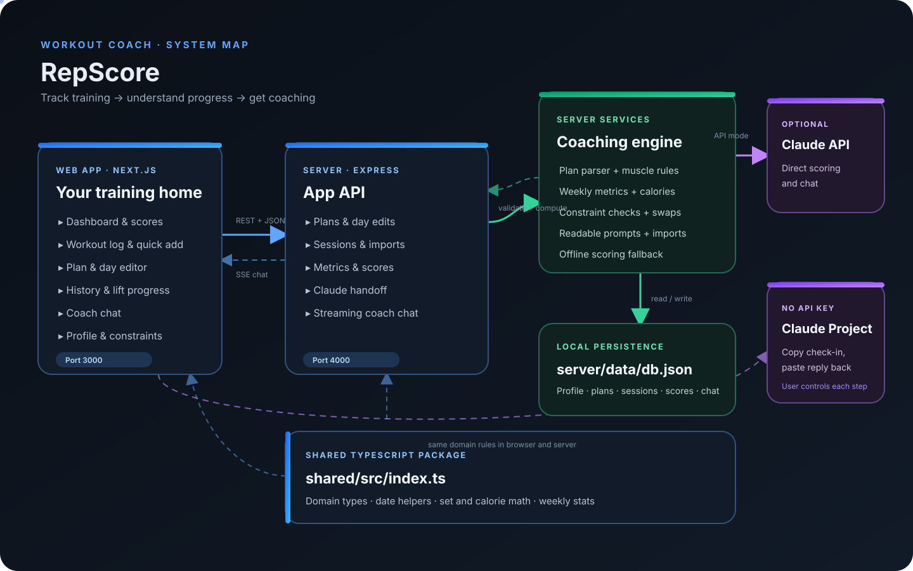

# StarkFitIQ — project overview

StarkFitIQ is a personal workout tracker and coaching app. It records training and daily health details, compares progress with a weekly plan, and turns saved logs into coaching feedback.

<p align="center">
  
</p>

## What it contains

- **Dashboard:** this week’s sessions, sets, live score, and coach review.
- **Workout log:** planned or custom exercises, sets, reps, load, cardio, RPE, bodyweight, food, steps, water, sleep, and notes. Quick Add can turn a plain-language day description into a saved log.
- **Plan editor:** weekly plan upload and day-by-day editing for exercise names, set and rep targets, and notes.
- **History:** logged workouts, calories, volume, and lift progress over time.
- **Coach:** chat with context from the profile, active plan, recent scores, and saved sessions.
- **Profile:** goal, experience, bodyweight targets, constraints, and an optional Claude Project link.

## How a weekly score is made

1. The API selects the week’s saved information through the latest logged date, so future planned workouts do not count as missed work.
2. Domain calculations produce adherence, rep-range quality, overload, muscle balance, recovery, and weekly stats such as calories, protein, steps, sleep, water, cardio, lifting volume, and bodyweight change.
3. Coaching can come from the Claude API, or from a manual copy-and-paste check-in to a Claude Project. The Project flow sends readable plan and log text, then imports Claude’s score reply.
4. The score report and weekly stats appear on the dashboard and in history.

## Repository map

| Path | Purpose |
| --- | --- |
| `client/src/app/` | Next.js screens: dashboard, log, plan, history, coach chat, profile, and auth pages |
| `client/src/components/` | Shared UI, navigation, logo, auth provider, quick-add, and Claude Project bridge |
| `client/src/lib/api.ts` | Browser API client (cookies, CSRF, silent refresh) and chat stream reader |
| `client/public/brand/` | Logo PNGs (horizontal, stacked, mark; dark- and light-background variants) used by `components/Logo.tsx` |
| `client/public/media/` | Landing page photos and videos |
| `client/src/components/landing/` | Landing page (sections, nav, styles) |
| `server/src/routes/api.ts` | Express endpoints for plans, sessions, scores, handoffs, and chat |
| `server/src/services/` | Plan parsing, metrics, constraints, Claude prompts, and day/score import |
| `server/src/repo.ts`, `server/src/db.ts` | MongoDB persistence, every query scoped to the signed-in user |
| `server/src/auth/`, `server/src/routes/auth.ts` | Argon2id passwords, JWT access/refresh cookies, rotation, CSRF |
| `server/src/services/ai.ts` | Per-user AI provider client (Anthropic + OpenAI-compatible APIs) |
| `server/src/seed/` | Initial profile and baseline plan |
| `server/src/domain.ts`, `client/src/lib/domain.ts` | Each app's own copy of the domain types, date helpers, metrics and calorie math (keep API types in sync) |
| `docs/project-overview.svg` | Animated architecture diagram used above |

## Run locally

```bash
npm install
cp server/.env.example server/.env
cp client/.env.example client/.env.local
npm run secrets -w server   # paste the output and your MONGODB_URI into server/.env
npm run dev
```

The web app runs at `http://localhost:3000`; the API runs at `http://localhost:4000/api`. Sign up to create an account. AI scoring is optional and per user: each user adds their own provider key (Claude, OpenAI, Gemini, Groq, Mistral, OpenRouter or any OpenAI-compatible API) in Profile. Without a key, deterministic app scoring and the manual Claude Project workflow remain available.
