<div align="center">
  
  <br />
  <p><strong>Plan your training. Track every rep. Score your week. Get stronger.</strong></p>
  <p>
    
    
    
    
    
    
  </p>
</div>

## Your training, scored intelligently

StarkFitIQ is an AI workout coach that understands your training plan, workout history, goals and constraints. Log sets and reps, review your progress, score each training week and get practical coaching recommendations.

It is a web app (Next.js client, Express 5 + MongoDB API) where each user brings their own AI key, and every AI feature also works without one through copy and paste. The full daily training loop is built: onboarding, starter plan, check-in, live workout, summary, progress and a coach on every page. Nutrition (targets, an Indian food database, food and water logging, and adding food from a photo of a meal or a nutrition label) is built too. AI-generated plans are next; see [Status and roadmap](#status-and-roadmap).

<div align="center">
  
</div>

## Videos

| Video | Format | File |
| --- | --- | --- |
| End-to-end walkthrough (sign-up → onboarding → check-in → plan → live workout → summary → exercises → nutrition → log → progress → profile → AI coach), about 5 min | 16:9 | [docs/demo/e2e-workflow.mp4](docs/demo/e2e-workflow.mp4) |
| Promo ad, 60 s | 16:9 | [voice-over](docs/ad/starkfitiq-ad-60s-16x9.mp4) · [with music](docs/ad/starkfitiq-ad-60s-16x9-music.mp4) |
| Promo ad, 30 s | 9:16 (phone) | [voice-over](docs/ad/starkfitiq-ad-30s-9x16.mp4) · [with music](docs/ad/starkfitiq-ad-30s-9x16-music.mp4) |

## What you can do

- **Guided onboarding** — a short setup after sign-up (goal, body, training, equipment, injuries, diet, optional AI key) that resumes where you left off.
- **Rule-based starter plan** — your answers pick a split and exercises from a built-in library; injuries remove exercises that load that joint. No AI needed.
- **Today screen** — today's workout with a Start button, readiness from your check-in, training streak and a coach tip.
- **Live workout with a start-to-finish timer** — the clock runs from server timestamps, so it survives reloads and a locked phone. Pause, resume, finish (even half-done, with a warning) or discard. A rest timer starts when you tick a set, with a beep, vibration and a background notification.
- **Workout summary** — time, sets, volume, personal records, "vs last time" per exercise, and a coach note (AI automatically after Finish, or a prompt to paste into Claude without a key).
- **Coach chat on every page** — a bar at the bottom of each signed-in page. The coach knows which page you're on, and can propose changes (swap an exercise, change sets, move a workout, set rest) that only happen when you tap **Apply today** or **Apply to plan**, with undo.
- **Exercise library and detail** — 82 built-in exercises plus your own, searchable and filtered to your equipment and injuries; each with how-to steps, form cues, common mistakes, photo, YouTube link, your history chart and safer alternatives.
- **Progress** — bodyweight trend, strength (estimated 1RM) charts, personal records, a training calendar and totals.
- **Daily check-in** — weight, mood, sleep, energy, soreness and stress; two or more answers give a readiness verdict (ready to push / train as planned / go lighter).
- **kg or lb** — choose your unit once; every weight in the app follows it.
- **Track workouts** — record exercises, sets, reps, load, RPE, cardio and daily activity.
- **Build and review plans** — paste a Markdown workout plan and turn it into structured training days and exercises.
- **Score every week** — evaluate adherence, progressive overload, rep-range quality, muscle balance and recovery.
- **Review plan quality** — check weekly muscle volume, recovery days, session length and constraint safety.
- **Quick Add** — describe your day in plain language and turn it into a saved log (food, steps, water, sleep, training).
- **Respect constraints** — flag exercises that conflict with your profile and suggest safer alternatives.

## How it works

1. Sign up, then finish the guided setup to get a starter plan built around you (or skip it and keep the baseline plan).
2. Check in each morning and get today's readiness.
3. Tap **Start workout**: log sets with the timer and rest timer running, then **Finish** to see your summary.
4. Ask the coach anything from any page, and apply its suggested changes with one tap.
5. Watch strength, bodyweight and records on **Progress**; score each week with the app's metrics plus AI interpretation.

## The daily loop

<div align="center">
  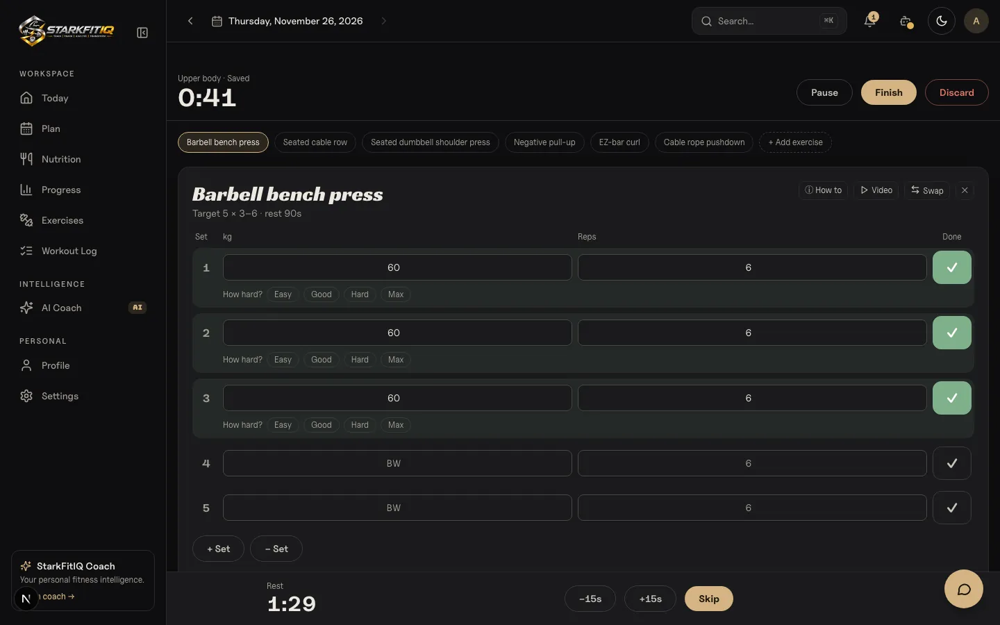
</div>

▶ **[Watch the end-to-end demo](docs/demo/e2e-workflow.mp4)** (about 5 minutes).

| Today | Check-in → readiness | This week |
| --- | --- | --- |
| 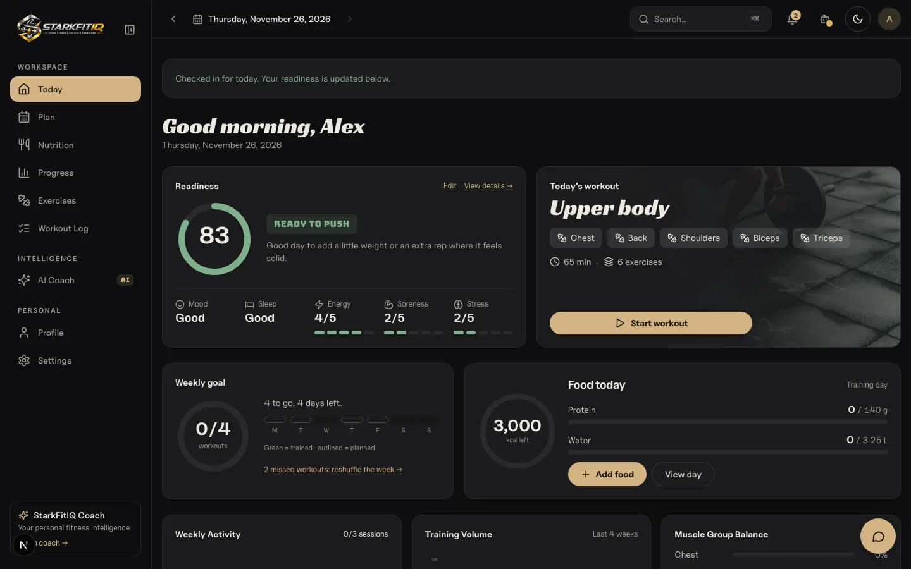 | 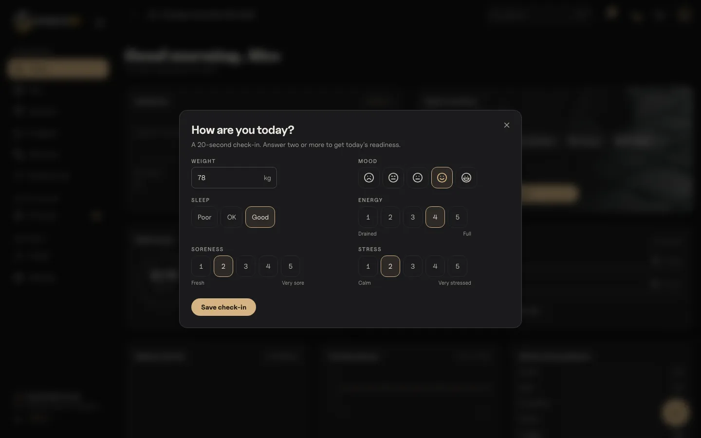 | 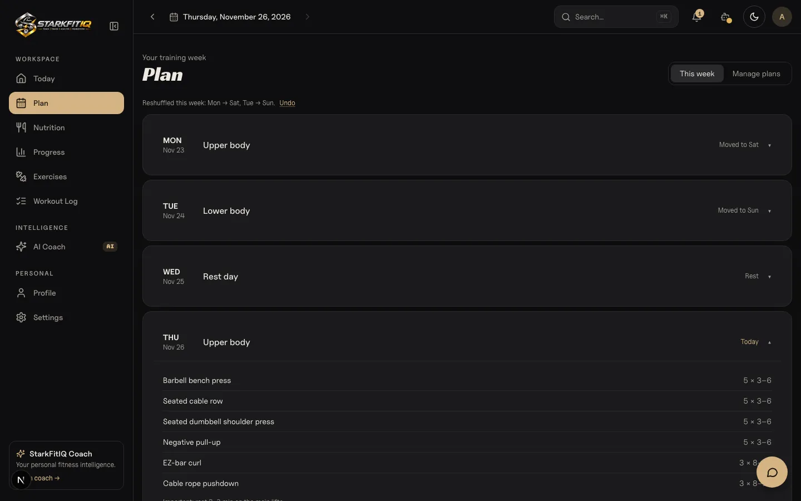 |

| Coach on every page | Finish with sets left | Workout summary |
| --- | --- | --- |
| 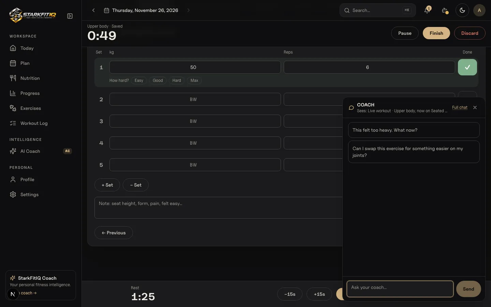 | 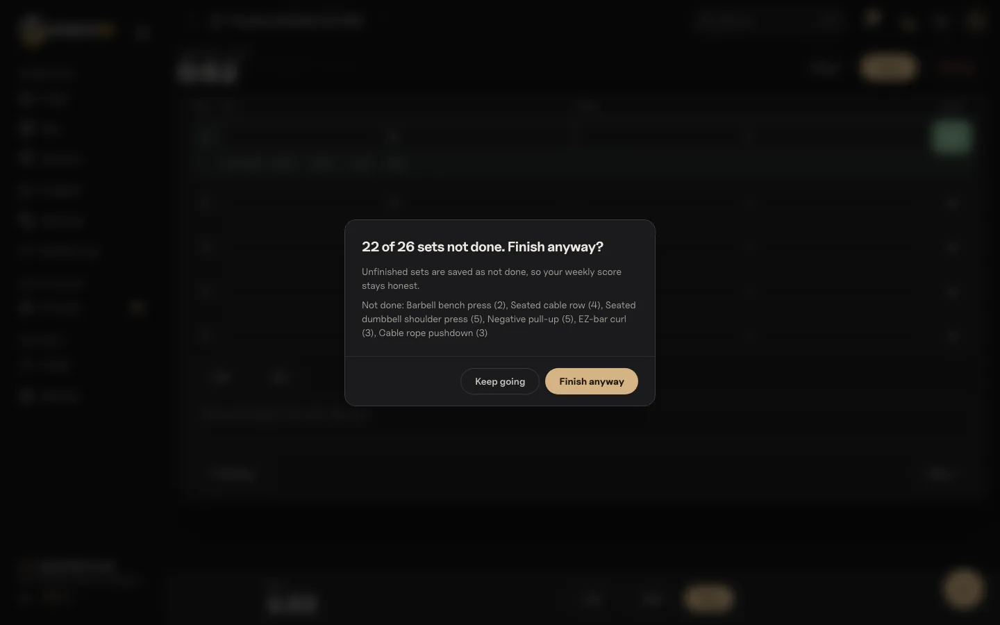 | 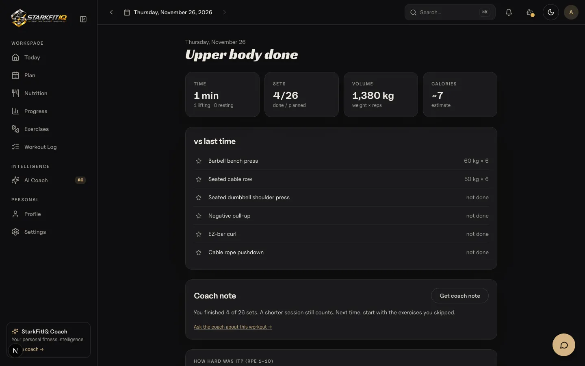 |

| Exercise library | Exercise detail | Nutrition |
| --- | --- | --- |
| 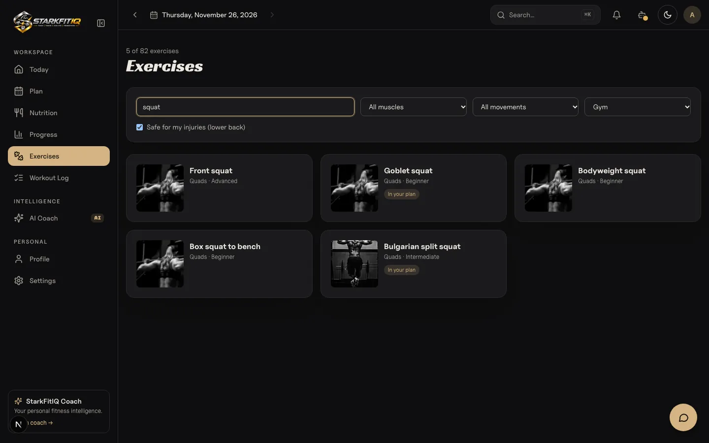 | 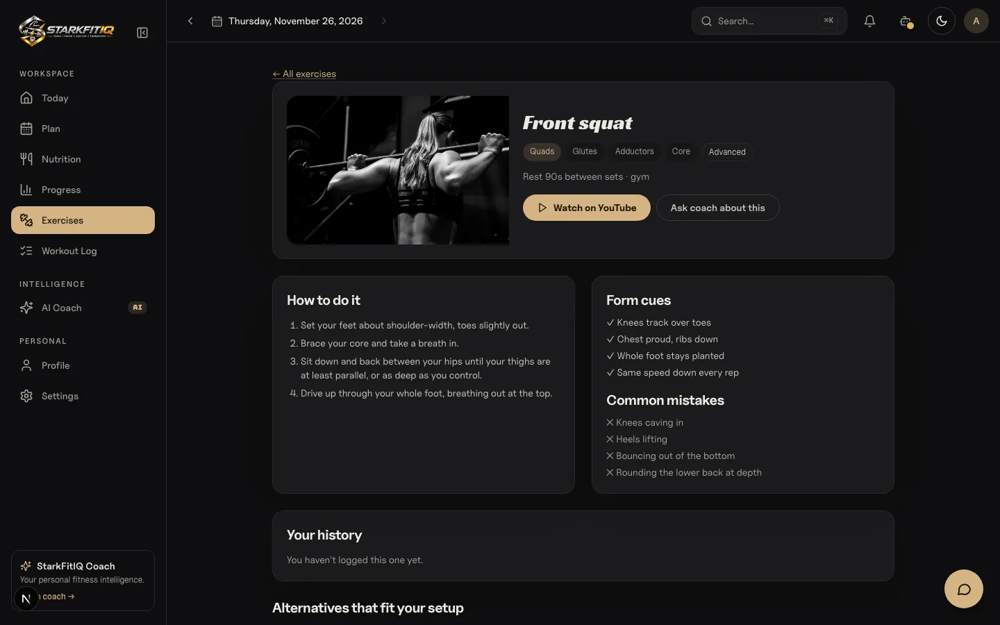 | 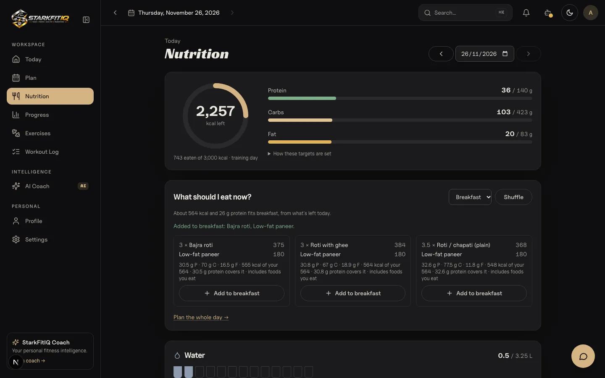 |

| Meal plan | Progress | Coach chat |
| --- | --- | --- |
| 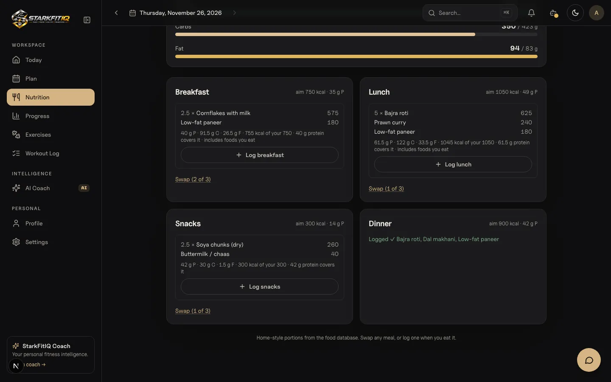 | 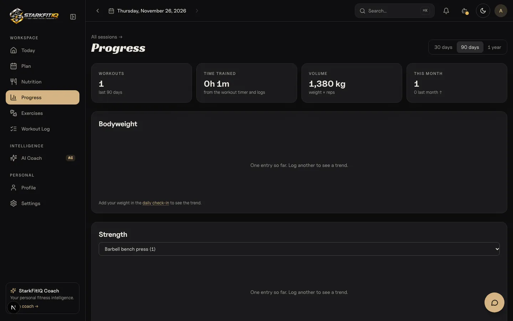 | 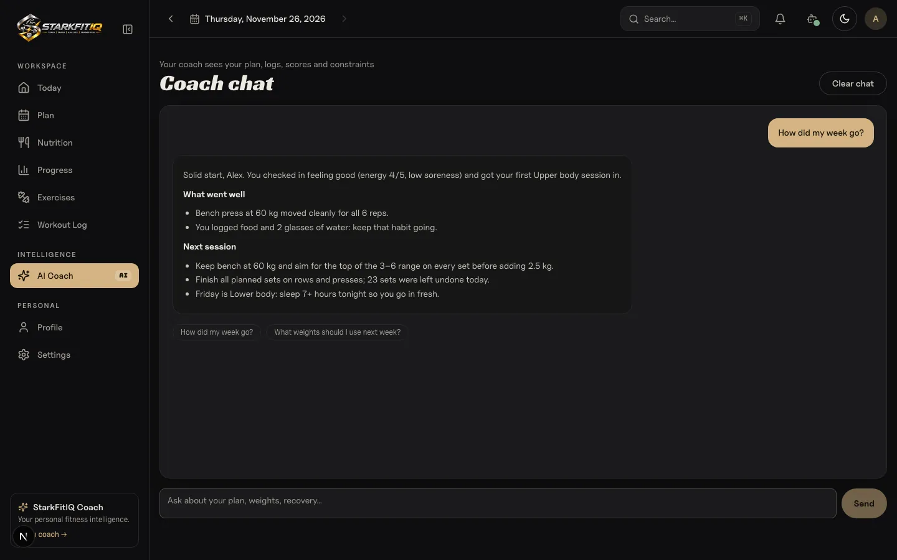 |

| Phone: Today | Phone: nutrition |
| --- | --- |
| 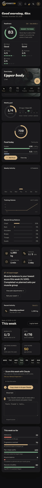 | 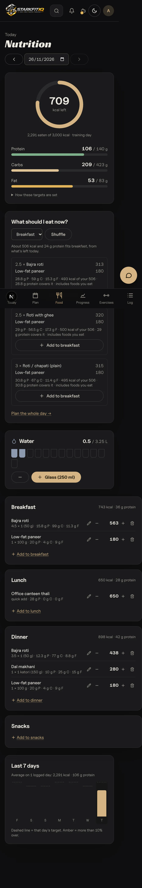 |

The images above live in [docs/screenshots/readme/](docs/screenshots/readme/). The full set (every page at desktop and phone size) is not committed: generate it into `docs/screenshots/desktop/` and `docs/screenshots/mobile/` with `node scripts/record-demos.mjs shots`, and re-record the demos with `node scripts/record-demos.mjs` (dev servers running).

**Without an AI key** every AI feature still works through copy and paste: the coach, the summary note and the weekly score hand you a ready-made prompt (with your plan, logs and scores) to paste into Claude, and you can paste the reply back, including any suggested changes as Apply cards.

Full design and build notes: [docs/app-completion.md](docs/app-completion.md).

## Onboarding

<div align="center">
  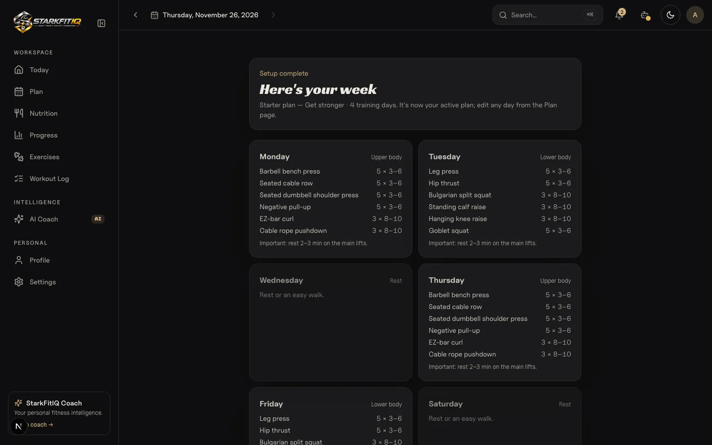
</div>

Sign-up and onboarding open the [end-to-end demo](docs/demo/e2e-workflow.mp4).

- **Sign-up** asks for name, email, age and password, so setup opens with **2 of 8 steps already done**.
- **Dashboard welcome card** for new users: *Continue setup* or *Skip for now*. Skipping keeps the baseline plan; you can finish later from **Profile → Finish setup**.
- **Eight steps**: Account ✓ · Basics ✓ · Goal · Body (kg/lb) · Training · Equipment & limits · Diet (optional) · AI coach (optional). Progress is saved after every step. The stepper and segmented bar show done steps in **green**, skipped optional steps in **red**.
- **Starter plan (no AI):** goal sets sets × reps, rest and cardio; days per week picks the split (2–6 days); session length caps the exercises per day; experience and equipment filter the library; injuries (knee, lower back, shoulder, wrist, elbow) exclude exercises that stress that joint and add matching constraints. Same answers always give the same plan. The library is `server/src/seed/workouts.json`.
- **"Here's your week"** shows the plan, which becomes your active plan; the old one stays in plan history. **Profile → Redo setup** builds a fresh one.
- **Daily check-in** appears on the dashboard on every visit until today's check-in is saved (weight, mood or sleep — any one is enough), then returns tomorrow.

| Sign-up | Daily check-in | Today |
| --- | --- | --- |
| 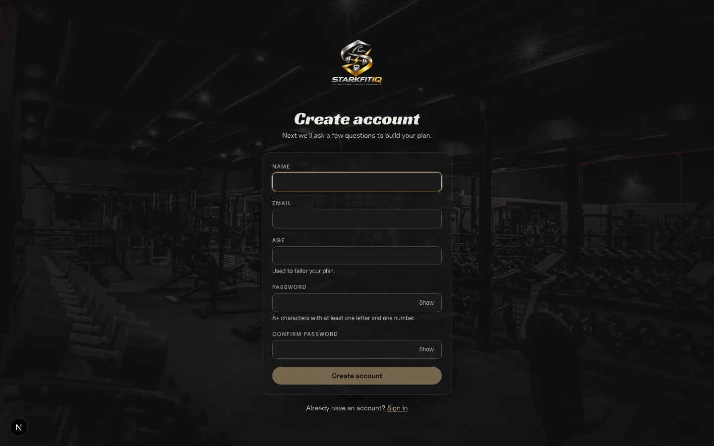 |  |  |

Full design and implementation notes: [docs/onboarding.md](docs/onboarding.md).

## Scoring model

The app calculates the ground-truth metrics first. Claude reviews those metrics alongside your plan and raw training logs.

| Metric               | Weight | What it measures                                            |
| -------------------- | -----: | ----------------------------------------------------------- |
| Adherence            |    35% | Planned sessions and sets completed so far in the week      |
| Progressive overload |    25% | Best estimated 1RM per lift compared with the previous week |
| Rep-range quality    |    15% | Share of working sets inside the plan's target rep range    |
| Muscle balance       |    15% | Completed versus planned sets by muscle group               |
| Recovery & safety    |    10% | Session RPE and constraint violations                       |

Mid-week scoring only counts training days that have passed. Scores stay grounded in app metrics; the AI adds interpretation, coaching and actionable adjustments.

## Status and roadmap

Measured against the product spec (18 P0 pages): **13 done, 3 partial, 2 missing**. Full audit and plan: [PRODUCT_PLAN.md](PRODUCT_PLAN.md).

| Area | Status |
| --- | --- |
| Accounts, onboarding, rule-based starter plan, daily check-in + readiness | Done |
| Live workout, rest timer, summary, PRs, exercise library and detail, swaps | Done |
| Progress, coach chat on every page with Apply/undo, profile and settings (kg/lb, cm/in, theme) | Done |
| Sign-up (email only; no Google or phone OTP), Today (no calorie/protein rings yet), plan (no drag reschedule) | Partial |
| Per-set effort, weekly goal ring, missed-session reshuffle, bodyweight trend, AI plan generator ([docs/training-upgrades.md](docs/training-upgrades.md)) | Built |
| Progressive overload targets, adaptive plan, readiness auto-adjusting the session | Partial |
| Nutrition page, Add food, food database (174 Indian-first foods), calorie, macro and water targets, photo of a meal or nutrition label, editing calories after adding, adaptive calories, "what should I eat now", meal planner ([docs/nutrition.md](docs/nutrition.md)) | Built |
| PWA / offline, data export, billing, per-user AI usage caps | Missing |

**Next up (Phase 1, in order):** stored progressive-overload targets, readiness that adjusts the session, adaptive plans, then hardening (tests for AI routes, usage caps, safety guardrails).

**Open decisions:** PWA vs React Native (recommended: PWA first), whether Pro includes built-in AI or users keep their own keys, The food data source is decided: a self-built Indian-first dataset for the MVP, with a licensed source later.

## Tech stack

- **Frontend:** Next.js 16, React 19, Tailwind CSS 4, TypeScript
- **Backend:** Express 5 API, bundled with esbuild
- **AI:** each user's own provider: Anthropic (Claude), OpenAI, Gemini, Groq, Mistral, OpenRouter or any OpenAI-compatible API
- **Storage:** MongoDB (Atlas)
- **Auth:** Argon2id, JWT access + refresh tokens in httpOnly cookies, Gmail SMTP (nodemailer) for email
- **Domain code:** each app has its own copy, `server/src/domain.ts` and `client/src/lib/domain.ts` (types, date helpers, score and calorie math). When you change an API type, update both

## Project structure

```text
workout-coach/
├── server/                         # Express API (port 4000)
│   └── src/
│       ├── domain.ts                # Server's domain types and helpers
│       ├── app.ts / index.ts        # Express app / startup (MongoDB connect + listen)
│       ├── db.ts / repo.ts          # MongoDB collections / per-user data access
│       ├── auth/                    # Argon2id, JWT cookies, CSRF, email tokens, key encryption
│       ├── services/
│       │   ├── starterPlan.ts       # Rule-based starter plan from onboarding answers
│       │   ├── exerciseLibrary.ts   # Exercise library: how-to text, images, alternatives, rest
│       │   ├── records.ts           # Personal records and "vs last time"
│       │   ├── readiness.ts         # Readiness score from the daily check-in
│       │   ├── planParser.ts        # Markdown plan → structured plan
│       │   ├── metrics.ts           # Deterministic training metrics
│       │   ├── constraints.ts       # Constraint rules and exercise swaps
│       │   ├── ai.ts                # Per-user AI provider client
│       │   ├── email.ts             # Gmail SMTP emails
│       │   └── claude.ts            # AI scoring and streaming chat prompts
│       ├── routes/                  # auth.ts, settings.ts, api.ts (REST + SSE),
│       │                            # onboarding.ts, checkins.ts, profileSchema.ts,
│       │                            # workout.ts (live timer, summary), insights.ts (today,
│       │                            # progress, exercises), coach.ts (actions, prompts, notes)
│       ├── test/harness.ts          # Shared in-memory MongoDB + app for API tests
│       └── seed/
│           ├── baseline-plan.md     # Plan new accounts start with
│           └── workouts.json        # Exercise library, split templates, injury rules
└── client/                         # Next.js app (port 3000)
    ├── src/
        ├── app/                     # Pages: Today (/dashboard), Plan, Progress, Exercises (+ detail),
        │                            # Live workout, Workout summary, Check-in, Log, History, Coach,
        │                            # Profile, Onboarding, login, signup, forgot/reset password, verify email
        │                            # (+ icon.png / apple-icon.png = browser tab icons)
        ├── components/              # Nav, Logo, auth provider, settings, UI,
        │                            # SetupCard, CheckinCard, onboarding/ (steps, stepper, plan reveal),
        │                            # coach/ (chat provider, dock, thread, action cards),
        │                            # workout/ (clock, rest alerts, live pill), MobileTabs, LineChart
        ├── lib/domain.ts            # Client's domain types and helpers
        ├── lib/api.ts               # API client (cookies, CSRF, silent refresh)
        ├── lib/units.ts             # kg/lb conversion and the per-user unit preference
    └── public/
        ├── brand/                   # Logo PNGs used by components/Logo.tsx
        └── media/                   # Stock photos (exercise images)
docs/
├── demo/, ad/                       # Product demo and promo ad videos
├── onboarding/, workflow/           # Walkthrough videos and screenshots
├── app-completion.md, onboarding.md # Design and build notes
└── *.svg                            # README / overview banners and diagrams
```

More background: [PRODUCT_PLAN.md](PRODUCT_PLAN.md) (spec vs reality and roadmap).

## Quick start

```bash
npm install
cp server/.env.example server/.env
cp client/.env.example client/.env.local
npm run secrets -w server   # prints JWT_ACCESS_SECRET, JWT_REFRESH_SECRET, ENCRYPTION_KEY
```

In `server/.env`, paste the three generated secrets and set `MONGODB_URI` to your MongoDB Atlas connection string (Atlas → Database → Connect → Drivers). In Atlas **Network Access**, allow your machine's IP. Then:

```bash
npm run dev
```

Open [http://localhost:3000](http://localhost:3000) and create an account (you'll land on the dashboard with a setup card; see [Onboarding](#onboarding)). Set `GMAIL_USER` and `GMAIL_APP_PASSWORD` first: the verification email is sent to your inbox, open its link to verify and you're in. The API runs at [http://localhost:4000](http://localhost:4000). The server refuses to start if any secret is missing or weak.
## Pages

| URL | Who | What |
| --- | --- | --- |
| `/` | Everyone | Hello page with a sign-in link |
| `/login`, `/signup`, `/forgot-password`, `/reset-password`, `/verify-email` | Everyone | Auth pages |
| `/dashboard` (Today), `/plan`, `/progress`, `/exercises`, `/exercises/[slug]`, `/checkin`, `/log`, `/history`, `/chat`, `/profile` | Signed in + verified | The app (coach chat bar on every page; bottom tab bar on phones) |
| `/workout/live`, `/workout/summary/[id]` | Signed in + verified | Live workout with timer; post-workout summary |
| `/onboarding` | Signed in + verified | Guided setup and starter plan |


## Accounts and security

- **Sign up, sign in, sign out, sign out everywhere, change password, revoke a device, delete account** (Profile → Account & security).
- **Email verification:** a link is emailed at sign-up (expires in 24 h, resendable, single use). The app stays locked until it's clicked (`REQUIRE_EMAIL_VERIFICATION`).
- **Forgot password:** "Forgot password?" on the sign-in page emails a one-time link (expires in 1 h). The response is identical whether or not the email exists. Resetting signs out every device and sends a "password changed" notice.
- **Email** goes through Gmail SMTP (`GMAIL_USER` plus a Google App Password in `GMAIL_APP_PASSWORD`). Link tokens are 256-bit random values stored only as SHA-256 hashes, auto-deleted by a TTL index, and removed from the address bar once read.
- **Passwords** are hashed with **Argon2id** (64 MiB, 3 passes) and rehashed automatically if settings get stronger.
- **JWT access token** (15 min) and **refresh token** (7 days) are stored in `httpOnly`, `SameSite`, `Secure` (in production) cookies, never readable by JavaScript. The refresh cookie is only sent to `/api/auth`.
- **Refresh-token rotation with reuse detection:** every refresh token works once and is stored only as a SHA-256 hash in MongoDB (auto-expired by a TTL index). Replaying an old one revokes that whole sign-in.
- **Instant revocation:** changing your password or signing out everywhere invalidates all outstanding access tokens.
- **CSRF protection:** an `Origin` check on every write, plus an `X-CSRF-Token` header bound to the session.
- **Rate limiting** on login (per IP and per email), sign-up, refresh and sensitive actions; generic login errors with constant-time checks, so attackers can't tell which emails exist.
- `helmet` security headers, strict CORS to `CLIENT_ORIGIN`, `Cache-Control: no-store` on the API, Zod validation on every input, and every database query scoped to the signed-in user.

Deploying client and API on **different sites** (e.g. `app.vercel.app` + `api.onrender.com`)? Set `COOKIE_SAMESITE=none`, `COOKIE_SECURE=true`, `NODE_ENV=production`, `TRUST_PROXY=true` and `CLIENT_ORIGIN=https://your-client`.

## AI coaching options

### Use your Claude Project — no API credits required

Every AI feature has a no-key path. The coach chat bar, the workout summary's **Get coach note** and the weekly score all give you a ready-made prompt to copy into Claude, and **Paste reply back** turns any suggested changes in Claude's reply into Apply cards.

StarkFitIQ can prepare a Markdown check-in containing your profile, plan, logged sets, metrics and the expected response format.

1. Add your Claude Project URL in **Profile**.
2. Select **Copy check-in & open Claude** on the Dashboard.
3. Paste the copied check-in into your Claude Project and send it.
4. Copy Claude's complete response, including its final JSON score block.
5. Paste it into StarkFitIQ and select **Import score**.

The same handoff flow is available for plan reviews and coach-chat context. StarkFitIQ does not sign in to or automate claude.ai; you manually copy and paste in both directions.

### Connect your own AI (optional, per user)

Each user adds their own key under **Profile → AI provider**. Supported: **Anthropic (Claude), OpenAI, Google Gemini, Groq, Mistral, OpenRouter**, or any **custom OpenAI-compatible** endpoint. Pick a provider, enter a model and key, and select **Check & save**. The key is tested with one tiny request, encrypted with AES-256-GCM (`ENCRYPTION_KEY`), and never sent back to the browser (only its last 4 characters are shown).

Custom base URLs must be HTTPS and public (private/loopback addresses are blocked to prevent SSRF). For a local model such as Ollama in development, set `ALLOW_PRIVATE_AI_URLS=true`.

Without a key, deterministic scoring and the manual Claude Project workflow remain available.

## Constraints and exercise swaps

Manage constraints from **Profile**. Each rule can match exercise keywords and provide suggested alternatives. Conflicts are surfaced in the plan, workout logging flow and score reports. Do not treat an exercise swap as medical advice; choose movements appropriate to your circumstances.

## API overview

| Method              | Endpoint                         | Purpose                                   |
| ------------------- | -------------------------------- | ----------------------------------------- |
| POST                | `/api/auth/register`             | Create account: name, email, password, age (16–90) |
| POST                | `/api/auth/login`                | Sign in (sets auth cookies)               |
| POST                | `/api/auth/refresh`              | Rotate refresh token, new access token    |
| POST                | `/api/auth/logout`               | Sign out this device                      |
| POST                | `/api/auth/logout-all`           | Sign out every device                     |
| GET / PATCH / DELETE| `/api/auth/me`                   | Current user, rename, delete account      |
| POST                | `/api/auth/change-password`      | Change password                           |
| POST                | `/api/auth/verify-email`         | Verify email with the emailed token       |
| POST                | `/api/auth/resend-verification`  | Send a new verification link              |
| POST                | `/api/auth/forgot-password`      | Email a password-reset link               |
| POST                | `/api/auth/reset-password`       | Set a new password with the emailed token |
| GET / DELETE        | `/api/auth/sessions[/:id]`       | List or revoke signed-in devices          |
| GET / PUT / DELETE  | `/api/settings/ai`               | Your AI provider (key never returned)     |
| POST                | `/api/settings/ai/test`          | Test the saved key                        |
| GET                 | `/api/status`                    | Your AI connection status and model       |
| GET / PUT           | `/api/profile`                   | Read or update profile (fields left out are kept) |
| PATCH               | `/api/profile/onboarding`        | Save a step's answers, `complete` (builds and activates the starter plan), `skip` or `restart` |
| GET / PUT           | `/api/checkins/:date`            | Today's check-in (`YYYY-MM-DD`, the user's local date), one per day; returns readiness |
| GET                 | `/api/checkins?from&to`          | Check-in history                          |
| GET                 | `/api/today?date=`               | Today screen in one call (plan day, live workout, check-in, streak, tip) |
| GET                 | `/api/progress?range=&date=`     | Bodyweight, strength series, PRs, calendar, totals |
| GET                 | `/api/exercises[/:slug]`         | Exercise library / detail with history and alternatives |
| GET                 | `/api/sessions/live`             | The workout in progress (and whether it's stale) |
| POST                | `/api/sessions/start`            | Start a live workout from a plan day or empty (`custom`) |
| PATCH               | `/api/sessions/:id`              | Autosave sets, rest timer, RPE, notes, duration |
| POST                | `/api/sessions/:id/pause` · `resume` · `finish` · `discard` | Timer controls (server timestamps) |
| GET                 | `/api/sessions/:id/summary`      | Workout summary: PRs, vs last time, rule-based note |
| POST                | `/api/sessions/:id/coach-note`   | AI coach note, or a prompt to paste when there's no key |
| POST                | `/api/coach/prompt`              | Ready-made prompt for chat or a coach note (no-key path) |
| POST                | `/api/coach/actions/apply`       | Apply a coach-proposed change (`today` or `plan`) |
| POST                | `/api/coach/actions/:id/undo`    | Undo an applied change                    |
| GET / POST          | `/api/plans`                     | List plans or upload Markdown             |
| PUT                 | `/api/plans/:id/days/:day`       | Edit a plan day                           |
| POST                | `/api/plans/:id/activate`        | Activate a plan                           |
| DELETE              | `/api/plans/:id`                 | Delete a plan                             |
| GET / PUT           | `/api/sessions`                  | Read or upsert workout logs               |
| GET                 | `/api/sessions/previous?before=` | Previous exercise performance             |
| DELETE              | `/api/sessions/:id`              | Delete a workout log                      |
| GET                 | `/api/metrics/week?date=`        | Weekly metrics                            |
| POST                | `/api/scores/plan`               | Score the active plan                     |
| POST                | `/api/scores/week`               | Score a training week                     |
| GET                 | `/api/handoff/week?date=`        | Build a weekly Claude check-in            |
| GET                 | `/api/handoff/plan`              | Build a plan-review check-in              |
| GET                 | `/api/handoff/context`           | Build coach-chat context                  |
| POST                | `/api/scores/import`             | Import an AI score report                 |
| GET / POST / DELETE | `/api/chat`                      | Chat history, streaming message (optional `page` context) and clear |

Additional day-import endpoints are available at `GET /api/day-import/prompt?date=` and `POST /api/day-import`. Everything except `/api/auth/register|login|refresh|logout|verify-email|forgot-password|reset-password` and `/api/health` requires a signed-in user (app data also needs a verified email); writes also need the `X-CSRF-Token` header returned by login/refresh/me.

## Scripts

```bash
npm run dev        # Start API and web app with hot reload
npm run build      # Build server and client
npm start          # Run production builds
npm test           # API end-to-end tests (auth, profile, onboarding, check-ins, live workout timer,
                   # coach actions, today/progress/exercises; in-memory MongoDB)
                   # + starter-plan, parser, constraint, metrics, readiness and PR tests
npm run typecheck  # TypeScript checks
npm run secrets -w server       # Generate JWT and encryption secrets
```

The auth tests start a throwaway MongoDB: they use `mongod` from your PATH if installed (e.g. `brew install mongodb-community`), otherwise download one into `node_modules/.cache` on the first run. Its data folder is `server/.mongo-test-*`, deleted after the run. They never touch your Atlas database.

## Data storage

Data lives in **MongoDB** (`MONGODB_URI`, database `MONGODB_DB`). Collections: `users`, `refresh_tokens`, `profiles`, `plans`, `sessions`, `scores`, `chat_messages`, `checkins`, `coach_actions` (applied coach changes with undo snapshots). A live workout is a session with `status: "in_progress"` and `startedAt` / `pausedMs` timestamps; scoring ignores it until it's finished. Weights are always stored in kg; the kg/lb setting only changes display and input. All training data carries a `userId` and is accessed only through `server/src/repo.ts`, which scopes every query to the signed-in user. Indexes are created on startup.

---

<div align="center">
  <strong>Show up. Log the work. Earn the score.</strong>
  <br />
  <sub>StarkFitIQ — an AI workout coach built around your actual training data.</sub>
</div>
```
